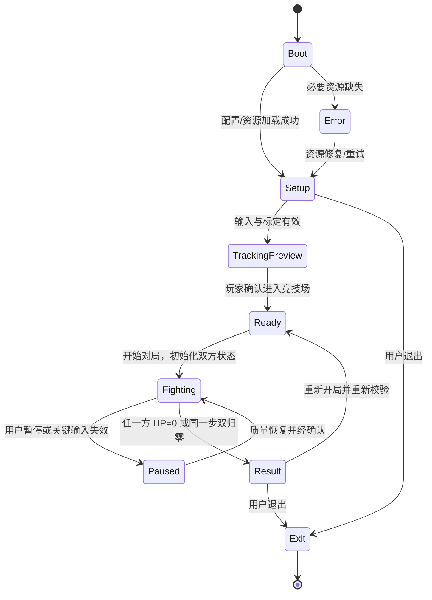
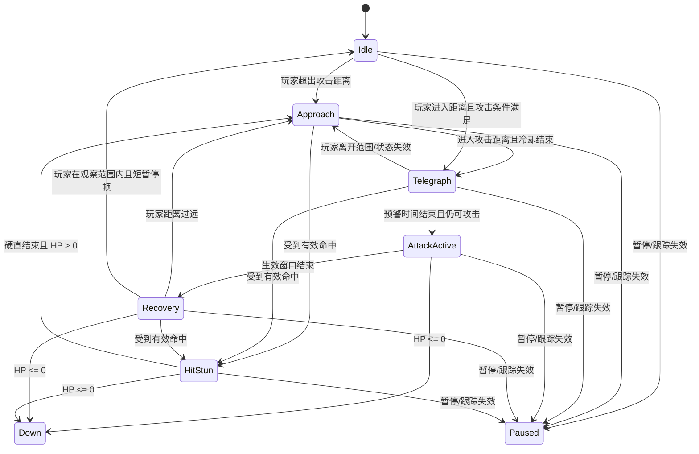

# C 成员详细设计 V2.0：3D Game Kit Level 1 / CircularArea 竞技场与战斗系统

> 项目：基于人体动捕的 1v1 三维格斗系统  
> 文档类型：成员 C 个人实现设计与开发任务书  
> 需求基线：调研与需求分析总览，SRS V1.5（2026-10-28），数据接口 v0.3  
> 负责人：史佳琪（C）  
> 引擎：Unity `6000.3.27f1` + URP（本版固定基线）  
> 状态：设计方案；阈值、时长、性能数字均需经原型试验确定

---

> **V2.0 场景基线变更（2026-10-29）**：本版废止“抽取少量环境资产并从零搭建 Arena”的旧方案。正式战斗场景以原始 `Level1` 场景完整副本为底，保留场景、灯光、建筑、角色和其他资源对象；`CircularArea` 及其周边地形作为主要 1v1 战斗区域。原始 Level 1 场景不覆盖、不重命名、不直接修改。竞技场模式通过新增的 `__CombatOverlay` 和显式组件引用接入。保留对象不意味着允许 Game Kit 原始控制器与新战斗逻辑同时驱动同一 Actor；冲突组件只在副本中按清单禁用，禁止删除第三方资产或批量清理整关对象。

> **需求范围优先级说明**：较早的项目总方案将闪避、体力等魂类机制列作总体方向；当前实现以 2026-10-28 的《1v1 三维格斗场景与规则》及 SRS V1.5 为首版验收基线：真实移动/转向、左右直拳、一种格挡、单只电脑怪兽、双方 HP、权威伤害、胜负/平局、暂停恢复与重开。踢腿、闪避/翻滚、体力条、连招和多人对战不进入当前 MVP，除非团队明确变更需求。

## 0. 一页看懂：你负责什么、不负责什么

### 0.1 C 的核心职责

C 负责将 B 提供的**已经完成角色驱动与约束的最终角色状态 `AvatarState`**转化为可玩的三维格斗体验：

1. **竞技场与镜头（FR-05）**：玩家、怪兽、地面、边界、战斗镜头、场景重置。
2. **电脑对手与怪兽 AI（FR-07）**：状态机、接近、攻击预警、出招、收招、受击、倒地。
3. **拳击、格挡、命中（FR-08）**：左右直拳检测、攻击阶段、Hitbox/Hurtbox、格挡方向、命中去重。
4. **战斗反馈和使用流程（FR-09）**：启动引导、状态提示、血条、命中反馈、暂停/恢复/退出/再开一局。
5. **本地会话与事件记录（FR-10）**：保存会话元数据、对局事件和结果；默认不记录原始 RGB、深度或逐帧骨架。
6. **对局与血量管理（FR-13）**：初始化血量、权威伤害结算、唯一胜负结果、双归零平局、局间隔离。

### 0.2 C 不负责的边界

| 不由 C 实现 | 负责成员 | C 的接收/配合内容 |
|---|---|---|
| 摄像机 SDK、原始 RGB-D、同步和标定 | A | 通过状态接口了解输入有效性；失效时暂停战斗 |
| 人体姿态模型、角色骨骼重定向、真实根节点和最终手部锚点 | B（A/B 共担部分姿态模型） | 只读取 `AvatarState`，不直接读取相机像素或模型原始关键点 |
| UI、特效和音效自行扣血 | 无人可以自行扣血 | UI/特效只订阅结算事件，HP 只能由战斗控制层维护 |
| 复杂的武器系统、踢腿、连招、投技、联网多人 | 后续拓展 | 首版不做，除非组内正式变更需求 |

**关键原则：**C 可以从最终的角色手部/躯干轨迹检测游戏攻击，但不得取代 B 的连续全身角色驱动；也不得把姿态识别的单帧预测直接当成命中结果。

### 0.3 最新首版范围（锁定）

- 1 名真人玩家 + 1 名电脑控制怪兽；单局 1v1。
- 使用 Level 1 的完整场景副本，以 CircularArea 及周边场景作为竞技场；玩家能移动、转向、接近和离开指定怪兽。
- 键鼠原型支持左右直拳与一种有效格挡姿态；接入动捕后读取 B 提供的最终角色状态和动作事件。
- 怪兽至少有待机、接近、攻击预告、攻击、收招、受击、倒地/死亡动画状态。
- 双方血条；命中、挥空、格挡有明确反馈；血量归零后结束，可重新开始。
- 跟踪、世界定位或必要手部输入失效时，停止双方战斗推进，并经确认恢复。
- 踢腿、翻滚/闪避、复杂连招、多名敌人同时参战和联网均不是首版验收项；Level 1 的其他角色对象仍保留在场景副本中，但由战斗模式名单决定哪些参与本局。

---

## 1. 设计目标与高质量格斗游戏的借鉴原则

本项目不是传统手柄格斗游戏的原样复刻。真人动作输入的识别会有噪声、延迟和个体差异，因此需要让操作更直观、反馈更清晰、失败更容易解释。

### 1.1 参考游戏与可迁移原则

| 参考 | 可借鉴的设计原则 | 本项目的转化方式 | 不照搬的内容 |
|---|---|---|---|
| 《Street Fighter 6》 | 为新手降低输入门槛，明确输入与动作结果；其官方说明提供 Classic、Modern、Dynamic 等不同控制方式 | 提供准备/校准/预览引导；把真人直拳映射为少量清晰动作；显示“识别到左拳/右拳/格挡”等诊断反馈 | 不复刻角色招式、UI、商标或专有资产；不实现复杂搓招与连招 |
| 《Sifu》 | 开发者介绍强调可信动作与视觉表现的平衡、可读的攻防节奏、格挡带来的防御代价、敌人攻击模式和反击窗口 | 怪兽先做可辨认的预警动作，之后才进入攻击生效，再进入收招；玩家可观察并通过拳击/格挡改变对局结果 | 不引入其结构值、年龄系统、处决、武器和多敌人系统作为首版需求 |
| 《Ghost of Tsushima》等动作游戏的敌人预警设计 | 清晰的视觉/声音提示能让玩家判断攻击即将到来并选择防御 | 预警阶段使用动作姿势、颜色提示和短音效；静音也必须可以通过视觉判断 | 不使用颜色作为唯一信号；不设计需要极高反应速度的首版招式 |

参考资料：
- Capcom Support, *What are the control types in Street Fighter 6?* https://www.capcom-support.com/hc/en-us/articles/7122030981660-What-are-the-control-types-in-Street-Fighter-6
- Sloclap / PlayStation Blog, *How Sifu’s kung fu combat works* https://blog.playstation.com/2021/11/18/how-sifus-kung-fu-combat-works/
- PlayStation, *A beginner's guide to Ghost of Tsushima* https://www.playstation.com/en-us/editorial/ghost-of-tsushima-beginners-guide/

### 1.2 本项目应贯彻的五条体验准则

1. **输入能理解：**真人动作触发攻击前，要有可调试的“候选攻击”状态；不把站立抖动或全身平移判成拳。
2. **攻击有时序：**每次攻击都有前摇、生效、收招和复位；只有生效窗口能造成伤害。
3. **敌人可读：**怪兽攻击前有预警，不允许无动画、无状态切换地瞬间扣血。
4. **反馈不含糊：**命中、挥空、被格挡、失去跟踪、胜利/失败采用不同的视觉反馈；声音关闭后仍可完成体验。
5. **规则唯一可信：**血量和胜负由唯一逻辑维护；界面、粒子和音效不能重复结算伤害。

---

## 2. Unity 工程和资源选型

### 2.1 建议技术栈

| 子系统 | 选择 | 原因与注意事项 |
|---|---|---|
| 引擎与脚本 | Unity + C# | 全组固定同一个 Unity Editor 版本，版本写进项目配置和 README |
| 渲染 | URP（已锁定） | 与当前已验证的国际版 3D Game Kit 资源路径保持一致；不切换 Built-in/HDRP |
| 动画 | Animator Controller / Animation Events | 将怪兽动画、状态机和攻击阶段分开；动画事件可辅助打开/关闭攻击窗口，但结算仍由 CombatResolver 执行 |
| 敌人寻路 | 简单竞技场优先距离/位置控制；若有障碍再使用 AI Navigation / NavMeshAgent | 不需要复杂寻路时避免为了一个平坦竞技场增加寻路复杂度；若使用 NavMeshAgent，不要同时让 Root Motion 与 Agent 无规则争夺位置 |
| 相机 | Cinemachine（若已纳入工程）或自建平滑跟随 | 镜头只负责构图，不影响真实世界坐标和命中几何 |
| 战斗参数 | ScriptableObject 配置资产 | 将攻击窗口、伤害、血量、AI 距离、预警时长集中配置，避免散落魔法数字 |
| UI | Canvas + TextMeshPro（或项目已安装的 UI 方案） | 血条、提示、暂停/结果面板分层管理 |
| 物理与检测 | Collider/Trigger + SphereCast 或采样扫掠 | 碰撞检测只提供候选接触；必须叠加攻击窗口、格挡、追踪质量和去重规则 |
| 日志 | JSONL 或 CSV（事件）+ JSON（会话/配置元数据） | UTF-8、字段版本、session_id/match_id 可追溯；原始动捕记录默认关闭 |

官方实现参考：Unity 的 Animator Controller 用状态机管理动画及过渡；ScriptableObject 适合集中共享配置；AI Navigation 提供 NavMesh 建立与运行时寻路；`Physics.OverlapBox` 可查询盒体重叠，Trigger 适用于事件检测，但不能直接代替本项目的战斗规则。

- Animator：https://docs.unity3d.com/cn/6000.0/Manual/class-AnimatorController.html
- ScriptableObject：https://docs.unity3d.com/cn/6000.0/ScriptReference/ScriptableObject.html
- AI Navigation：https://docs.unity3d.com/cn/current/Manual/com.unity.ai.navigation.html
- Physics.OverlapBox：https://docs.unity3d.com/ja/current/ScriptReference/Physics.OverlapBox.html
- Trigger 事件：https://docs.unity3d.com/6000.0/Documentation/Manual/collider-interactions-ontrigger.html
- Cinemachine：https://docs.unity3d.com/jp/current/Manual/com.unity.cinemachine.html

### 2.2 场景清单（以 Level 1 原场景副本为唯一战斗主场景）

首版不另外建一个空白 `Arena_01`，也不把 Level 1 拆成仅有地面、石柱的简化地图。正式场景命名建议为：

- 原始资源场景：包内 `Level1`（只读参考，保持原样）。
- 战斗副本：`Level1_CircularArena_Combat.unity`（通过 Unity 的 **Save As** 从 Level 1 另存得到）。
- 可选验证副本：如需做组件开关/相机试验，可再另存 `Level1_CircularArea_Test.unity`，但不得让它成为额外的正式入口。

不必为了演示先建 `Boot` 和 `Setup` 两个场景。准备、开始、暂停、结果面板优先作为战斗副本内的 UI 状态实现；后续如项目总集成确实需要，再由组内另行增加启动场景。

**复制与保护规则：**

1. 在 Project 面板定位本机实际导入包中的 `Level1` Scene，先备份工程/Git 提交，再使用 `File > Save As` 另存为 `Level1_CircularArena_Combat.unity`。
2. 不要只复制 Hierarchy 中的一组对象，也不要先清空场景。保存后确认复制场景打开正常，原始 `Level1` 仍可无损打开和运行。
3. 不修改任何第三方 Prefab 源文件，不重命名原始 GameObject，不批量挪动所有环境根对象。所有战斗逻辑和对原关卡行为的兼容层放在 `_Project` 自有目录。
4. 以当前工程里的真实层级、组件和对象引用为准。以下设计里的 `CircularArea` 是用户指定的区域名；Codex 必须在实际 Level 1 中搜索并确认其完整路径、Transform、Collider/Renderer 边界，不能假设它一定是场景根节点。

### 2.3 `Level1_CircularArena_Combat` 场景结构与对象保留策略

**原 Level 1 的现有 Hierarchy 原则上保持不动。** 不把第三方层级强行整理成自定义结构，以免破坏序列化引用、SceneLinkedSMB、事件、灯光和关卡逻辑。只在场景根层级新增一个本项目自有的分组：

```text
Level1_CircularArena_Combat
├── [Level 1 原始全部根对象与子层级：保留，不重排]
│   ├── CircularArea（按实际完整路径确认）
│   ├── 原地形、地面、墙体、装饰、灯光、Volume、Camera/Rig
│   ├── 原有人物与敌人（例如 Ellen、Chomper 及其他实际存在的角色）
│   └── 原关卡触发器、机关、UI、管理器和导航数据（先保留，再逐项评估冲突）
└── __CombatOverlay（本项目新增，不进入第三方 Prefab 源）
    ├── ArenaModeController
    ├── ArenaReferences
    │   ├── CircularAreaReference
    │   ├── PlayerSpawn
    │   ├── MonsterSpawn
    │   └── ArenaBoundsDebug（只用于辅助显示）
    ├── CombatParticipants
    │   ├── PlayerReference -> 现有 Ellen/确认后的人形角色
    │   └── MonsterReference -> CircularArea 附近的指定现有怪兽
    ├── CombatSystems
    │   ├── MatchController
    │   ├── CombatResolver
    │   ├── CombatConfig
    │   ├── InputAdapter
    │   ├── MonsterAIController
    │   ├── SessionEventLogger
    │   └── RecoveryBridge
    ├── UI_Overlay（仅补充必要 HUD/结果/暂停 UI，不重复创建第二套相机）
    └── Debug
        ├── CombatGizmos
        └── StateDebugOverlay
```

#### 对现有人物的处理规则

- **玩家**：优先复用 Level 1 的 Ellen 实例作为视觉角色，保留模型、骨架、材质和原动画资产。将她的原始 `PlayerController`、原始输入桥、原版近战/伤害逻辑列入“可能冲突组件清单”；在战斗副本中根据 Inspector 实际检查结果禁用会重复写 Transform、Animator、HP 或攻击结算的组件，不删除组件与 GameObject。
- **主要对手**：优先从 Level 1 现有角色中选用位于 CircularArea 内或最靠近该区域的 Chomper（若现场实际存在且模型/动画可用）。如果 CircularArea 周边没有 Chomper，使用关卡里现有的一个 Chomper，并只在副本中将其移动到 `MonsterSpawn`；不得额外用 Quaternius 怪兽替换它，除非 Chomper 无法满足基本动画/碰撞要求并由开发者确认降级。
- **Level 1 的其余人物/敌人**：保留 GameObject、Renderer、Animator 和原有资源，不从场景删除。为确保“1 名玩家 + 1 名电脑怪兽”的局内规则，可在 `ArenaModeController` 的显式列表中禁用非参战角色的原始 AI、旧 Damageable/ContactDamager 或自动攻击行为；默认只禁用行为脚本，不禁用外观。只有角色挡住竞技场、持续攻击参战者或改写 HP/场景状态时，才在副本中加单独开关或移位方案并记录原因。
- **武器/手持道具**：不删除原始对象。如果拳击视觉与 Ellen 的法杖不一致，允许在战斗副本的 `ArenaModeController` 中提供“仅隐藏指定 Renderer”的可选外观覆盖；默认先不启用，待拳击动画确定后由开发者在 Inspector 决定。原 Prefab 与原始 Level 1 不受影响。

#### 不可变原则与脚本冲突边界

1. 不允许 `PlayerController` 与新 `PlayerMotionAdapter` 同时写玩家根节点；不允许旧 `Damageable` 与 `CombatResolver` 同时扣血；不允许旧 `EnemyController/ChomperBehaviour` 与新 AI 同时控制怪兽位置和攻击状态。
2. 不要对整个 `CircularArea` 根对象一键删除/禁用：它可能包含环境、地面、碰撞体或子对象。用完整路径逐个检查。
3. 不要无差别关闭场景全部 Collider、Animator、灯光或管理器。先生成检查报告，再按 Inspector 显式引用启停组件。
4. 若旧关卡触发器会将玩家传送、切场景、重置 HP 或播放教程 UI，只在战斗副本禁用其对应行为/事件；保留地形与视觉。不要因一个冲突删掉整个场景对象。
5. 原版 Level 1 继续作为可回退基准；所有新脚本、配置、UI 和自建 Prefab 放在 `Assets/_Project/`。

### 2.4 文件夹组织

```text
Assets/_Project/
├── Scenes/
├── Scripts/
│   ├── Core/              # ExperienceManager, MatchController, ConfigService
│   ├── Arena/             # ArenaSceneController, FightCameraController
│   ├── AI/                # MonsterAIController, MonsterStateMachine
│   ├── Combat/            # AttackDetector, GuardDetector, CombatResolver, Hitbox
│   ├── UI/                # CombatHUD, PausePanel, ResultPanel, FeedbackPresenter
│   ├── Recording/         # SessionRepository, EventRecorder, ExportService
│   ├── Integration/       # AvatarStateAdapter, TrackingRecoveryBridge
│   └── Debug/             # CombatGizmos, StateDebugOverlay
├── Data/
│   ├── CombatConfig/
│   ├── MonsterAIConfig/
│   ├── ArenaConfig/
│   └── UIConfig/
├── Prefabs/
│   ├── Player/
│   ├── Monster/
│   ├── Hitboxes/
│   └── UI/
├── Animations/
├── Materials/
├── VFX/
├── Audio/
└── Tests/
```

---

## 3. 端到端架构与模块边界

```text
A/B 动捕驱动模块
  AvatarState (最终场景根节点、拳部/胸部锚点、时间戳和有效性)
                    │
                    ▼
       AvatarStateAdapter（C：校验字段/时效/质量）
             ┌──────┴─────────┐
             ▼                ▼
      AttackDetector      GuardDetector
       左/右直拳事件        格挡有效性/方向
             └──────┬─────────┘
                    ▼
              CombatResolver ◄──── MonsterAIController
             命中候选/有效窗        敌方攻击事件
                    │
                    ▼
              MatchController
           唯一应用伤害、HP与胜负
             ┌──────┼────────┐
             ▼      ▼        ▼
           HUD/UI  Feedback  Session/Event Recorder
```

### 3.1 类职责与建议接口

| 类/接口 | 主要方法 | 责任边界 |
|---|---|---|
| `ArenaSceneController` | `LoadArena()`、`ResetActors()`、`ValidateAssets()` | 装载竞技场与角色引用，检查缺失的 Rig、Animator、锚点和配置 |
| `FightCameraController` | `SetTargets()`、`LateUpdate()`、`ResetView()` | 始终尽量同时构图玩家与怪兽；不改变碰撞或世界坐标 |
| `AvatarStateAdapter` | `TryGetLatest(out AvatarState)`、`IsFresh()` | 将 B 的具体数据结构封装成 C 内部接口；不要复制另一套字段定义 |
| `AttackDetector` | `UpdateTrajectory()`、`TryBeginPunch()`、`OnPunchRecovered()`、`CancelAll()` | 识别左右直拳状态，生成唯一 `attack_id`，处理复位、冷却及取消 |
| `GuardDetector` | `UpdateGuardPose()`、`CanBlock(AttackContext)` | 判断姿态、必要关节质量、方向覆盖和时效 |
| `MonsterAIController` | `TickAI()`、`PauseAI()`、`ResumeAI()`、`CancelAttack()` | 电脑对手状态、距离决策、攻击预警与动画触发 |
| `MonsterAttackDriver` | `BeginTelegraph()`、`OpenActiveWindow()`、`CloseActiveWindow()` | 管理怪兽攻击窗口与攻击 ID；窗口可由配置/动画事件驱动 |
| `Hitbox` / `Hurtbox` | `EnableForAttack()`、`Disable()`、`GetActorId()` | 只描述空间区域和目标归属，不直接扣血 |
| `CombatResolver` | `RegisterHitCandidate()`、`ResolveStep()`、`Deduplicate()` | 汇总并验证命中、格挡、攻击窗口、去重；将有效伤害批次提交给 MatchController |
| `MatchController` | `BeginMatch()`、`PauseMatch()`、`ResumeMatch()`、`ApplyDamageBatch()`、`FinishMatch()`、`Rematch()` | 权威维护 HP、match 状态和唯一结果；禁止 UI 或 AI 直接修改 HP |
| `CombatHUD` | `RenderMatchState()`、`RenderFeedback()` | 只读 `MatchState` 与事件，不计算伤害 |
| `FeedbackPresenter` | `OnHit()`、`OnBlocked()`、`OnWhiff()`、`OnTrackingLost()` | 触发可读的屏幕提示、VFX、音效和轻量镜头效果，不改变战斗状态 |
| `SessionRepository` | `BeginSession()`、`AppendEvent()`、`FinishSession()`、`Export()`、`DeleteSession()` | 会话与事件数据的唯一写入口，处理序号和失败状态 |
| `RecoveryBridge` | `OnInputInvalid()`、`OnInputRecovered()`、`ConfirmResume()` | 接受 B/全局跟踪服务的失效通知，暂停战斗，确认后恢复 |

---

## 4. 对局完整生命周期

### 4.1 总状态机



### 4.2 每一阶段的规则

**Boot**
- 验证 `CombatConfig`、`MonsterAIConfig`、UI、玩家和怪兽 prefab 是否存在。
- 检查怪兽 Animator 参数、攻击挂点和 Hurtbox；缺项要在诊断面板指出，不能假装准备就绪。
- 事件记录服务失败时，若记录并非开局硬依赖，可给出警告并以显式降级方式运行；不可静默丢记录。

**Setup / TrackingPreview**
- 展示输入/标定是否有效、玩家骨架或角色预览以及开始条件。
- C 不进行相机标定；只订阅 A/B 结果。
- 用户在追踪状态无效时按“开始”，必须拒绝进入 Ready，并解释是设备、标定、身份还是必要关节失效。

**Ready**
- 将玩家和怪兽重置至配置出生点；清空攻击、受击、碰撞去重、AI 状态和上局延迟事件。
- 初始化双方当前血量为最大血量，建立新的 `match_id`。
- 用户确认后才切换到 Fighting。

**Fighting**
- 启动敌人 AI；接受玩家拳击和格挡输入；在有效攻击窗口执行三维检测。
- HP 只由 `MatchController` 更新。每一结算步先收齐双方伤害，统一更新 HP，再判胜负，避免“同帧先更新者先赢”的偶然结果。

**Paused**
- 玩家、怪兽、AI 决策、攻击窗口、伤害、冷却和对局时间全部冻结。
- 清除未完成攻击及其 hitbox，防止恢复后穿越命中。
- 动捕采集与跟踪恢复检查仍可继续；恢复需要身份、标定、映射有效并得到用户确认。
- 保留当前 HP，不自动重开。

**Result**
- 只显示一次胜、负或平局；停止任何新伤害。
- 结果面板提供“再来一局”和“退出”。再来一局产生新 `match_id`，彻底清空旧攻击 ID、去重集合和延迟命中候选。

---

## 5. 竞技场与镜头设计（FR-05）

### 5.1 竞技场目标与 CircularArea 现场测绘

本项目的场景不是新搭建的独立圆形地牢，而是**Level 1 原场景副本中的 CircularArea 和它的周边场景**。保留周边遗迹的视觉关系和 Level 1 原人物，使竞技场看起来属于原关卡，而不是悬浮在一块新地板上的测试房间。

开工时按顺序完成一次现场测绘，并把实测信息保存至 `Docs/CircularArea_SceneAudit.md`：

1. 在 Hierarchy 搜索 `CircularArea`，记录对象完整路径、Position/Rotation/Scale、是否有 Collider、主要子对象以及渲染边界。
2. 在 Scene View 中确认地面连续范围、周边墙体/柱体、可站立区域、可见但不可进入区域、摄像机遮挡和玩家可能掉落/卡住的位置。
3. 读取现有 Collider/Renderer 边界或用 Gizmos/临时标记估算边界。没有核实尺寸前，不要把文档中的示例米数写成实际场景数据。
4. 玩家与怪兽出生点放在 CircularArea 内相对两侧，开局面向彼此，不能与地面、柱体或互相重叠。优先使用场景实际坐标，不硬编码假设原点为圆心。
5. 使用 Level 1 原有地面与墙体 Collider。若边界缺失，只在 `_Project` 新增可启停的隐形 ArenaBoundary Collider，且必须用现场测试调整位置；不能为方便另建一整块覆盖原地形的 Ground。
6. 保留周边景物，必要时只调整相机遮挡对象或参战角色实例位置。不要为简化碰撞而整体搬动/删除环境模块。

**首版几何约束：**战斗区内移动、退让与转身应连续；场景装饰不应遮住拳部/怪兽上半身；任一方不能穿出可通行边界；所有伤害计算以世界三维坐标和碰撞体为依据，不能使用画面重叠判定。

### 5.2 镜头行为（优先复用 Level 1 相机）

- 第一选择是**保留 Level 1 中现有的 Main Camera/CameraRig**，检查其当前跟随目标、输入脚本和层级。只有能在不破坏环境呈现的前提下接入玩家/怪兽构图，才继续复用。
- 在战斗副本内，禁用的是与新相机冲突的相机输入/跟随组件，而不是删除整套相机对象。确保运行时只有一台负责主画面的相机，不叠加两套 AudioListener。
- 战斗构图目标为玩家与怪兽的中点附近；至少要同时看到玩家双臂与怪兽攻击姿态。间距变化时平滑调整偏移或视野，避免一方轻易出画。
- 保留 Level 1 的既有灯光与环境 Volume。相机/渲染调整不能破坏已修复的 URP 材质。
- 如果圆形区域外围存在遮挡，先在真实游戏视角查看并调整相机碰撞/构图，再决定是否禁用某些遮挡物 Renderer；不允许用移动 Actor 来掩盖镜头穿墙。
- 镜头震动默认关闭或极轻，并可通过配置禁用，便于测试命中与动捕抖动。
- 不论摄像机如何移动，命中几何、格挡朝向和玩家根节点都使用世界坐标或明确定义的角色局部坐标，不从屏幕位置推断距离。

### 5.3 场景验收

- 打开的场景文件是 `Level1_CircularArena_Combat.unity`，来源可追溯到原 Level 1 的副本；原始 Level 1 未被覆盖。
- 原 Level 1 的环境、灯光、人物、敌人和其他场景资产均仍在副本中；所有因战斗冲突而禁用的组件在 `CircularArea_SceneAudit.md` 中有路径、组件名、原因和启用条件。
- `CircularArea` 的完整 Hierarchy 路径和场地边界有实际审计记录；没有凭空假定其尺寸或原点。
- 玩家和指定怪兽分别有明确 Spawn 点；开局不重叠、不悬空、不嵌入障碍物。
- 战斗模式只启用一名人形玩家与一名指定怪兽作为当前对局角色；其他角色仍保留在场景，不向这一局写入 HP/伤害/胜负。
- 旧控制器不会覆盖新玩家根节点；旧敌人 AI 不会覆盖新怪兽状态机；旧 Damageable 不会并行扣血。
- 场地实际地面与边界碰撞正确；相机不把任何一方永久遮挡；切换/暂停/重开不触发原版关卡传送、教程或重置脚本。

## 6. 怪兽角色、Rig 与资产（FR-07）

### 6.1 怪兽与人物资产的最低要求（Level 1 优先）

本版使用 Level 1 已存在的人物，不以 Quaternius 人形模型替换关卡角色。

**玩家默认方案：**复用 Level 1 中的 Ellen 场景实例与其模型、骨架、材质和可用的 Idle/Walk/Run 资源。战斗副本可单独指定新的 Animator Controller 或动画层，但必须先读取当前 Rig、Avatar、Animator Controller 和真实 Clip 名；原始 Prefab 与原 Level 1 不修改。原版玩家控制/战斗脚本是否需要禁用，必须根据组件清单确定。

**怪兽默认方案：**在 Level 1 中选择 CircularArea 内或周边最适合做 1v1 对手的一只既有怪兽，首选现有 Chomper（如实际存在并且动画可用）。保留怪兽的模型、材质、Rig、Animator 和原动画资源。其他现有怪兽不删掉，也不自动成为同一局的参战者。

**拳击动画缺口：**3D Game Kit 的 Ellen 原生近战动作可能是持杖攻击，不应假定它包含左右徒手直拳。先枚举当前工程可用的 AnimationClip，建立 `Docs/AnimationClipMap.md`。如确实没有可用于左右直拳的动作，才从此前规划的 Quaternius Universal Animation Library 2 中挑选兼容 Humanoid 的补充 Clip；要先验证 Ellen Avatar 的 Humanoid 重定向、手部轨迹与脚底，不允许直接猜名字或默认兼容。Free Those Who Fighter Animations 仅作后备导入测试。

**关卡其他人物：**如 Level 1 中存在 Spitter、Grenadier 或其他角色，保留其 GameObject 和可见资产。竞技场模式只对明确非参战角色的原 AI/攻击组件执行配置化禁用，避免它们参与本局；不把它们替换成新包中的模型。

对任一角色至少检查：网格、材质、Rig/Avatar、身高与方向、脚底、Animator、现有动画、攻击/受击区域，以及与 Unity `6000.3.27f1` + URP 的兼容性。未经本机测试不得声称资产已完全兼容。

### 6.2 怪兽 Animator 设计

首版尽量使用简洁的 Animator Controller，参数统一命名并写入文档：

| 参数 | 类型 | 用途 |
|---|---|---|
| `MoveSpeed` | Float | 待机/移动混合，若采用 Blend Tree |
| `TriggerAttack` | Trigger | 进入攻击动作 |
| `TriggerHit` | Trigger | 播放受击反应 |
| `TriggerDown` | Trigger | 进入倒地/死亡动作 |
| `IsPaused` | Bool | 暂停展示/禁止行为；实际冻结仍由代码统一管理 |
| `IsDead` | Bool | 结束态保护，禁止重新攻击 |

不要让 Animator 单独决定 HP、对局胜负和是否有效命中。Animation Event 可以告知“某个动作的预定生效帧到了”，但必须检查当前 MatchState、当前 attack_id 和配置窗口，避免暂停后旧事件继续结算。

### 6.3 资产验收清单

- 模型朝向轴、地面轴心、身高尺度、Avatar/Rig 配置已确认。
- 所有必需动画能正确播放；过渡时无明显 T-pose、错骨骼或模型穿地。
- 怪兽攻击挂点随动画正确移动；受击区域大小、位置可在 Scene Gizmos 中观察。
- 角色处于受击/倒地/收招时，不会立刻重入攻击。
- 找不到授权或动画不齐的资产应尽早替换，不能将整个项目押在一个无法使用的模型上。

---

## 7. 怪兽 AI 设计：可读、稳定、容易调参

### 7.1 首版 AI 状态机



建议另设全局 MatchState 门控，而非把“暂停”只做成某个动画状态：只要 MatchState 不是 Fighting，AI 的 `TickAI`、新攻击启动、攻击窗口和 HP 结算必须拒绝推进。`Down/Dead` 是终态，只有新 Match 初始化可以重置。

### 7.2 AI 行为流程

**观察与转向**
- 目标固定为当前 `PLAYER` actor_id，不允许临时换目标。
- 计算水平面上的目标方向（去掉 Y 分量），以 `turnSpeed` 平滑调整朝向。
- 在 `Telegraph` 开始时完成瞄准；`AttackActive` 期间不突然瞬移转向追踪玩家，攻击判定按已配置的动画轨迹执行。

**接近**
- 若距离超过攻击距离，向目标方向移动到一个停止半径，而不是每帧贴脸。
- 简单无障碍竞技场可使用自写的水平移动/朝向；只有需要障碍路径时再使用 NavMesh。
- 玩家和怪兽之间设置最小间距，减少模型穿插；这只是移动约束，不应把玩家角色硬吸附到怪兽旁边。

**攻击预警**
- 怪兽先播放一个能被看见的抬手、蓄力或后撤动作；可配合非侵入的提示音/特效。
- 预警时间必须比动作生效早；UI 只作辅助，不能只显示一个看不懂的颜色变化。
- 如果玩家已离开范围，首版可选择取消攻击并回到接近；如果不取消，则攻击动画和碰撞应自然落空，二者选一种并写进配置，不能根据玩家是否要被打中临时作弊。

**攻击与收招**
- 每次怪兽攻击生成唯一 `attack_id`；只在生效窗口开启 Hitbox。
- 命中/挥空后都必须进入 `Recovery`，收招期间不能启动下一次攻击。
- `HitStun` 可中断普通接近和预警；是否能打断生效中的攻击需有固定规则，建议首版允许有效命中打断预警/收招，但不允许同一帧临时切换后重复结算。

### 7.3 简单 AI 决策伪代码

```csharp
// 伪代码：仅描述决策次序，不能直接视为可编译实现
void TickAI(float dt)
{
    if (matchState != MatchState.Fighting || isDead) return;
    if (!playerAvatarState.IsTrackingValid) return; // 上层应已触发全局暂停

    switch (state)
    {
        case MonsterState.Idle:
            FacePlayer(dt);
            if (distance > attackRange) Enter(Approach);
            else if (attackCooldown <= 0f) Enter(Telegraph);
            break;

        case MonsterState.Approach:
            FacePlayer(dt);
            MoveTowardPlayerUntil(stopDistance, dt);
            if (distance <= attackRange && attackCooldown <= 0f)
                Enter(Telegraph);
            break;

        case MonsterState.Telegraph:
            FacePlayer(dt); // 只在预警前/预警内按规则调整
            if (!AttackStillAllowed()) CancelAttackAndApproach();
            else if (stateTimer >= config.telegraphSeconds) StartAttackWindow();
            break;

        case MonsterState.AttackActive:
            // Hitbox 活跃与否由明确窗口控制；这里不直接扣血
            if (stateTimer >= config.activeSeconds) Enter(Recovery);
            break;

        case MonsterState.Recovery:
            if (stateTimer >= config.recoverySeconds) Enter(Idle);
            break;
    }
}
```

### 7.4 首版 AI 不做什么

不需要行为树、强化学习、大模型、复杂的随机人格或多敌人战术。有限状态机已经足以展示电脑对手的主动行为，并更容易写测试。可加入轻微的攻击间隔变化，但应保持可复现的种子或固定模式，便于验收。

---

## 8. 玩家直拳与格挡的战斗规则（FR-08）

### 8.1 战斗事件分为三层

1. **运动观测：**B 提供最终角色锚点（左右拳、肘、肩/躯干参考点）、世界位置、时间戳与追踪有效性。
2. **意图识别：**C 的 `AttackDetector`/`GuardDetector` 判断是否形成有效直拳或格挡姿态。
3. **游戏结算：**`CombatResolver` 根据攻击窗口、最终三维空间、目标 Hurtbox 和格挡方向，生成唯一结算结果；`MatchController` 更新 HP 与 MatchState。

不能跳过第 2 层，直接因为拳头坐标穿过怪兽身体就打出伤害；也不能只靠“检测到挥拳类别”无视拳头实际是否接触目标。

### 8.2 直拳检测建议

**输入：**最终角色空间中的左右拳锚点、同侧肘/肩参考、胸部/躯干参考点、身体朝向、骨架质量、时间戳和当前 MatchState。

**检测原则：**
- 用拳相对胸部/肩部的局部位移与伸展变化，避免整个身体向前移动就自动产生拳击。
- 优先检测向前快速运动，同时参考肘部伸展/回收；不能只对单帧速度设绝对阈值。
- 必要关节缺失、数据过期、玩家暂停或对局已结束时，不允许启动新攻击。
- 生成唯一 `attack_id` 后进入阶段状态；同一拳必须先复位再允许下一次触发。
- 阈值应通过不同身高、拳速和站位样本校准，集中放在 `CombatConfig`，不可散落代码。

**每拳状态：**

```text
Ready
  └─检测到有效左/右直拳候选且质量合格→ Windup
        ├─候选失效/输入失效/暂停→ Cancelled
        └─前摇计时结束→ Active
              └─生效窗口结束→ Recovery
                    └─拳部回到复位区 + 冷却结束→ Ready
```

`Windup` 是可选的短暂确认状态，用于过滤噪声；`Active` 仅控制攻击判定窗口；`Recovery` 阻止连续噪声反复触发。取消攻击时必须禁用 Hitbox，并记录取消原因。

### 8.3 格挡判定建议

格挡不是“手在胸前就永远无敌”。一个有效的首版格挡需要同时满足：

1. 用户处于预先定义的有效防御姿态；
2. 所需肩、肘、腕关节追踪质量及时间戳有效；
3. 来袭攻击方向位于配置的正面覆盖范围；
4. 命中时玩家没有暂停、失效或结束；
5. 该防御姿态在怪兽攻击生效时仍处于有效状态。

**当前需求规则：**有效正面格挡使本次伤害为零；无效姿态、侧后方攻击或过期姿态按普通命中处理。首版无需格挡耐力/体力条、弹反、完美格挡或招架反击；这些会显著增加识别与调参成本，放在拓展项。

### 8.4 Hitbox / Hurtbox 设计

**玩家：**攻击 Hitbox 使用 B 驱动后最终的 `LeftFist` / `RightFist` 锚点；身体 Hurtbox 可先用头部、躯干、腿部的简化胶囊或球体，首版也可以统一为一个躯干 Hurtbox，但配置必须明确。

**怪兽：**攻击 Hitbox 绑定怪兽自身攻击挂点；Hurtbox 绑定怪兽 Rig 的躯干/头部等受击区域。

**推荐做法：**
- 快速拳头使用上一个物理步到当前步的拳部路径进行扫掠（例如 `SphereCast` 或等价的连续检测），降低高速拳“穿过”碰撞体而漏检的风险。
- 对普通近战动作可用 Trigger 或 Overlap 查询产生候选碰撞；用 LayerMask 区分攻击、受击、环境，避免自己的 Collider 被命中。
- Hitbox 只在 `Active` 开启；前摇、收招、Paused、Result 一律禁用。
- 检测到 Collider 只登记候选，不在 `OnTriggerEnter` 回调里直接扣 HP。
- 一个攻击可以碰到目标多个受击区域，但同一 `attack_id` 对同一目标只结算一次。
- 物理帧、动画帧和动捕时间戳之间要记录来源；不要用不受控的 `Time.timeScale = 0` 单独暂停某几个系统而造成不一致。建议由统一 MatchState 门控所有战斗时钟。

Unity 官方文档：Trigger 的回调可用于接触事件；`Physics.OverlapBox` 可查询当前区域内的碰撞体；它们并不自动提供攻击阶段、格挡、去重或胜负规则。

### 8.5 命中验证条件

命中必须同时满足：

```text
MatchState == Fighting
AND input/tracking valid and fresh
AND attack state == Active
AND target is an opponent actor
AND 3D hitbox intersects opponent hurtbox in a valid physics step
AND guard rule evaluated
AND (match_id, attack_id, target_actor_id) not previously resolved
```

以下情况明确不能扣血：
- 攻击前摇或收招碰撞；
- 玩家只是站立抖动、缓慢摆手或整体身体前移；
- 玩家和怪兽在屏幕上重叠但三维深度分离；
- 身体普通接触，没有有效攻击状态；
- 同一拳连续多帧贴着目标；
- 同一拳碰到怪兽多个 Hurtbox；
- 暂停或追踪失效期间出现的残留触发事件；
- 对局已结束。

---

## 9. 战斗数值与配置设计（CFG-09）

### 9.1 配置原则

所有攻击条件、阶段时长、冷却、血量、伤害、碰撞半径、AI 距离、预警时间、格挡角度和恢复阈值均集中在可编辑配置资产。具体值是本项目需要实测确定的参数，不能把下表中的起始建议当成已验证的最终值。

### 9.2 ScriptableObject 配置结构建议

```csharp
[CreateAssetMenu(menuName = "Combat/Attack Definition")]
public class AttackDefinition : ScriptableObject
{
    public string attackName;          // Player_LeftPunch / Monster_Claw
    public float windupSeconds;
    public float activeSeconds;
    public float recoverySeconds;
    public float cooldownSeconds;
    public float damage;
    public float hitRadius;
    public LayerMask targetLayers;
    public bool canBeGuarded;
}

[CreateAssetMenu(menuName = "Combat/Combat Config")]
public class CombatConfig : ScriptableObject
{
    public float playerMaxHp = 100f;
    public float monsterMaxHp = 100f;
    public AttackDefinition leftPunch;
    public AttackDefinition rightPunch;
    public AttackDefinition monsterAttack;
    public float guardFrontAngle;
    public float playerRearmDistance;
    public float minPoseConfidence;
    public float maxInputAgeMs;
}
```

代码示例只展示字段组织方式；生产实现还需加上范围验证、版本字段、伤害大于等于 0 的限制，以及序列化/导出需求。对外数据结构以接口 v0.3 为准，不应把此示例当成新接口契约。

### 9.3 初次调参建议（仅作实验起点）

| 参数 | 初始调试思路 | 如何测量/调整 |
|---|---|---|
| 玩家最大 HP | 双方先使用相同基准值（例如 100） | 保证 UI、伤害和胜负测试易理解 |
| 直拳伤害 | 设为固定整数值（例如 10） | 每拳伤害应有可见差异但不会一击结束；实际用测试对局调整 |
| 怪兽近战伤害 | 固定且低于/接近玩家拳击伤害（例如 8） | 让玩家能通过格挡和合理出拳完成一局 |
| 攻击前摇 | 足够看出怪兽动作，但不让玩家必须做超快速反应 | 采集至少 20 次测试，确认能看懂并来得及格挡 |
| 生效窗口 | 足以覆盖动画攻击经过玩家的时间，但不允许整段动画一直有伤害 | 调试 Gizmos 可见，边界逐帧检查 |
| 收招/复位 | 必须阻止连续误触发，并给玩家读懂动作的时间 | 测高频挥拳时 attack_id 是否稳定、是否需要重新复位 |
| AI 攻击距离 | 与真实玩家活动尺度匹配，稍有余量而不贴脸 | 记录不同站位下开始预警、实际命中距离 |
| 格挡正面角 | 先宽松一些以适应体感误差，再逐步缩小 | 正面/斜侧/背侧做固定用例，不能靠主观观察调参数 |
| 输入超时 | 与 B/A 共同确定，不允许 C 自行改出另一套失效定义 | 用断流与延迟注入验证统一暂停 |

这些仅为调试起点，不可写成已达到的性能或最终数值。每次参数更改要升级配置版本，并记录适用的测试数据。

---

## 10. 伤害结算与状态一致性（FR-13）

### 10.1 单一权威写入点

- `CombatResolver` 收集本结算步的候选命中，并依据攻击阶段、目标、格挡和去重规则生成有效伤害结果。
- `MatchController` 是双方当前 HP、MatchState 和最终胜负结果的唯一写入者。
- UI、怪兽 AI、VFX、音频和日志都不能自行扣血；它们只能调用明确的请求或订阅结果事件。

### 10.2 事件去重

建议去重键：`(match_id, attack_id, target_actor_id)`。

- `match_id`：每一局唯一。
- `attack_id`：每一次合法攻击开始时创建一次；不能每个碰撞帧都生成新的 ID。
- `target_actor_id`：明确玩家或怪兽身份。

当一拳同时触碰多个怪兽 Hurtbox 时，先将同一目标合并，再尝试结算；不能按 Collider 个数计算伤害。对同一个攻击重复收到事件，必须保持幂等。

### 10.3 同一结算步与双归零

1. 收集本步所有合法伤害；
2. 同时应用格挡规则；
3. 汇总每个 Actor 的本步总伤害；
4. 更新双方 HP 并 Clamp 到 `[0, maxHP]`；
5. 若玩家 HP=0、怪兽 HP>0，玩家失败；反之玩家胜；同一步双方 HP 都为 0，则平局；
6. 只发布一个最终结果，锁定对局并关闭攻击区域。

不要在 `OnTriggerEnter` 里逐个即时改 HP，否则同时命中时先执行的对象可能影响另一个对象是否能完成本步命中，造成非确定性。

### 10.4 暂停与再开局

- `PauseMatch(reason)` 幂等；多次暂停请求不能反复改变状态。
- 暂停时取消所有活动 AttackContext，关闭 Hitbox，清空未结算的候选命中；保持当前 HP。
- 恢复前校验 `AvatarState` 的身份、时间戳、定位和标定有效性，由用户明确确认后恢复。
- `Rematch()` 只允许在 Result 状态运行；生成新 match_id，初始化 HP、AI、出生点、攻击 ID 和去重集合。
- 上一局的延迟事件若抵达，因 match_id 不同必须被丢弃。

---

## 11. HUD、反馈与交互流程（FR-09）

### 11.1 HUD 的基本布局

- 左上：玩家血条、玩家标签。
- 右上：怪兽血条、怪兽名称。
- 上方中间/低干扰位置：当前对局状态（准备、战斗、暂停、胜利、失败、平局）。
- 屏幕中下：短时战斗反馈（“命中”“被格挡”“挥空”）；不可遮挡拳部与怪兽攻击动作。
- 边缘状态提示：追踪正常/失效、需要重新定位/确认继续。
- 暂停/结果面板：继续、重新开始、退出；暂停和退出不能依赖人体动作输入。

### 11.2 要做的反馈

| 事件 | 视觉反馈 | 音频/特效 | 系统行为 |
|---|---|---|---|
| 玩家拳触发 | 极短提示或 Debug 面板显示左拳/右拳 | 轻微出拳音（可关闭） | 创建 AttackContext，进入前摇 |
| 命中怪兽 | 怪兽受击动画、短暂闪白/材质反馈、HP 减少 | 命中音、少量粒子 | 只调用一次 CombatResolver→MatchController 结算 |
| 玩家挥空 | 可选非常轻的风声，不必弹大字 | 低强度音效 | 不改变 HP |
| 怪兽开始预警 | 明确的蓄力/抬手/后撤动作，必要时辅助图标 | 短音提示 | 显示可防御窗口，随后进入攻击 |
| 玩家格挡成功 | 可靠的防御姿态+怪兽攻击受阻反馈 | 格挡音/轻微特效 | 本次伤害为 0；事件记录 `blocked=true` |
| 玩家受击 | 玩家/虚拟角色受击动画或短暂视觉反馈，玩家 HP 减少 | 命中音 | 一次伤害结算 |
| 追踪丢失 | 屏幕中央明显提示“动作追踪中断，对局已暂停” | 不必须播放声音 | 冻结双方战斗与计时，继续监测输入 |
| 胜负/平局 | 结果面板和最终 HP | 结果提示音（可关闭） | 禁止后续命中，等待再开局或退出 |

**反馈原则：**只在有效事件发生时反馈。不要让每个未通过阈值的拳部抖动都显示“攻击失败”，避免界面噪声。普通使用界面隐藏复杂的模型置信度和内部变量，开发诊断模式再显示。

### 11.3 新手使用流程

```text
启动 → 设备/标定状态检查（A/B 提供） → 角色预览
→ 明确确认开始 → 初始化对局 → Fighting
→ 玩家移动/出拳/格挡 ↔ 怪兽预警/攻击/受击
→ 一方 HP=0 → Result（胜/负/平）
→ 再开一局（新 match_id、清空旧状态）或退出
```

暂停/退出按钮应始终可由键盘/鼠标触发，不应要求动捕必须正常才可暂停。

---

## 12. 本地会话与战斗事件记录（FR-10）

### 12.1 记录边界

默认保存：
- `session_id`、`match_id`、开始/结束时间、应用/配置版本；
- 双方角色资产、初始化 HP、结果；
- 攻击事件、命中/挥空/格挡、伤害和 HP 前后值；
- 暂停、跟踪丢失、恢复、再开局和配置变更事件；
- 可选性能摘要（FPS、处理耗时、丢帧数），具体采样规则由全组统一。

默认不保存：原始 RGB 视频、深度帧和逐帧完整骨架。若课程实验确实需要这些数据，必须使用显式录制开关、说明记录类别和用途，并提供导出/删除入口。

### 12.2 InteractionEvent 建议字段

接口 v0.3 的精确字段是共同契约；下面仅用于说明事件信息的语义，字段命名应以全组最终数据接口文件为准。

```json
{
  "schema_version": "0.3",
  "session_id": "session-example",
  "match_id": "match-example",
  "event_id": "evt-example",
  "event_seq": 17,
  "attack_id": "atk-example",
  "attacker_actor_id": "player",
  "target_actor_id": "monster",
  "event_type": "HIT",
  "hit_part": "TORSO",
  "blocked": false,
  "damage": 10,
  "hp_before": 100,
  "hp_after": 90,
  "simulation_step": 1842,
  "source_timestamp_ms": 123456
}
```

### 12.3 会话记录实现建议

- 初版可以把每个互动事件追加写入 JSON Lines（每行一个合法 JSON），会话摘要写入单独 JSON；若团队已使用 SQLite，则遵循 03 设计说明中的表结构。
- 采用单一 `SessionRepository`，避免多个脚本分别打开同一个文件。
- 写入失败时记录“待保存/保存失败”状态，不能静默失败。
- 每局结束写入总结：双方初末 HP、结果、总攻击数、命中数、被格挡数、暂停/恢复次数。
- 导出数据标明格式版本、单位、时钟和来源；按会话删除时只删除确认指定的对象及其关联文件。

---

## 13. 调试模式与 C 的验收测试

### 13.1 Debug overlay

提供可关闭的诊断面板，至少显示：
- MatchState 与 MonsterAIState；
- 玩家 `AvatarState` 的数据年龄、必要关节有效性；
- 左/右拳状态机（Ready/Windup/Active/Recovery/Cancelled）；
- 当前 `attack_id`、目标 Actor ID；
- Hitbox/Hurtbox 的 Gizmos；
- 上次有效命中/格挡及原因；
- 双方 HP、上一次结算序号；
- 暂停原因（手动暂停、输入过期、世界定位失效等）。

### 13.2 必测用例（与 TC-04/05/06/08/09 对应）

| ID | 场景 | 预期结果 |
|---|---|---|
| C-01 | 开场资源检查 | 缺少怪兽 Animator/攻击挂点/Hurtbox 时阻止进入 Ready，并说明缺项 |
| C-02 | 怪兽在攻击距离外 | 怪兽持续接近，不穿越竞技场边界；进入范围后预警 |
| C-03 | 怪兽攻击预警 | 可看到/理解预警；预警期间不扣血 |
| C-04 | 玩家有效左直拳命中 | 生效窗口内命中一次，怪兽 HP 只减少一次 |
| C-05 | 玩家有效右直拳命中 | 规则与左拳一致，事件 ID 不重复 |
| C-06 | 玩家站立抖动/缓慢摆手 | 不生成有效攻击，不产生伤害 |
| C-07 | 纯身体平移前进 | 不自动被判作直拳；角色移动本身仍可正常工作 |
| C-08 | 直拳挥空 | 无 HP 变化，动作完成后可以复位再次出拳 |
| C-09 | 拳头处于前摇/收招但与怪兽碰撞 | 不扣血 |
| C-10 | 生效窗口内持续多帧接触 | 同一 attack_id 只扣一次 HP |
| C-11 | 同一次攻击碰到怪兽多个 Hurtbox | 只结算一次伤害 |
| C-12 | 画面重叠但 3D 深度分离 | 不判命中 |
| C-13 | 有效正面格挡 | 玩家不掉血，反馈为格挡成功 |
| C-14 | 格挡姿态失效或侧后方攻击 | 不被误判为有效正面格挡，按既定命中规则处理 |
| C-15 | 玩家或怪兽被打至 0 HP | 正确进入 Result，停止后续攻击 |
| C-16 | 同一结算步双方都归零 | 只产生一个平局结果 |
| C-17 | 追踪在怪兽预警/生效时丢失 | 双方移动、AI、攻击、伤害、冷却和对局时钟冻结；攻击取消 |
| C-18 | 恢复跟踪后未确认 | 仍暂停，不继续战斗 |
| C-19 | 确认恢复 | 保留 HP、清理旧攻击，再进入 Fighting |
| C-20 | Result 中旧碰撞事件延迟到达 | 被拒绝，不改 HP 和结果 |
| C-21 | 再开一局 | 新 match_id，血量复位，旧攻击去重集合和事件不会污染新局 |
| C-22 | 关闭音效 | 所有关键流程仍有视觉提示，能够完成比赛 |
| C-23 | 删除会话 | 先确认范围，仅删除所选会话及明确关联数据 |

### 13.3 测试方法

- 每一个规则正例配至少一个相反的负例；特别验证“窗口外不伤害”和“同一拳不会重复扣血”。
- 固定玩家起始位置、怪兽起始位置、配置版本和攻击动作，保证复测可比较。
- 先在键盘/自动模拟输入中测试战斗规则，再接入真实动捕；但最终验收必须包含真实移动和真实姿态输入，不能仅凭键盘模式判定通过。
- 导出测试事件日志，使用 `match_id`、`attack_id`、事件顺序和 HP 前后值交叉核验。
- 性能目标由 SRS/项目统一测试方案规定；C 不单独承诺未测过的帧率或延迟。

---

## 14. 开发阶段、交付物和完成标准

### S1：工程骨架与基础场景

**任务**：固定 Unity `6000.3.27f1` + URP；在不覆盖原 Level 1 的前提下另存 `Level1_CircularArena_Combat.unity`；审计 CircularArea 的完整路径、地面、边界、灯光、相机、Ellen、候选 Chomper 和其他人物；新增 `__CombatOverlay`、Spawn 点和可配置组件冲突清单。

**交付物**：战斗场景副本、`Docs/CircularArea_SceneAudit.md`、原始/副本差异记录、可运行截图/视频、README。

**完成标准**：保留所有原有场景内容与人物；可以进入副本并看到 CircularArea 与周边场景；原始 Level 1 仍可单独打开；即使禁用旧玩法脚本也不删除任何原资产。

### S2：怪兽动画与 AI

**任务**：接入怪兽模型和必要动画；完成状态机；实现接近、预警、攻击生效、收招、受击、倒地。

**交付物**：`MonsterAIController`、`MonsterAIConfig`、Animator 参数清单、AI 状态调试 overlay。

**完成标准**：固定模拟目标时，怪兽可重复执行完整攻击周期；预警、攻击、收招严格区分，暂停时停止。

### S3：HP、攻击和命中

**任务**：实现 `AttackDetector`、`GuardDetector`、Hitbox/Hurtbox、`CombatResolver` 和 `MatchController`；先使用键盘或测试点模拟左拳、右拳、格挡。

**交付物**：战斗组件、配置资产、正负用例、事件日志、HP/胜负 UI。

**完成标准**：通过 C-04 至 C-16；没有重复扣血，胜负和平局唯一结算。

### S4：体验流程和恢复集成

**任务**：设备/标定状态展示；暂停、恢复、退出、再开局；接收 B 的最终 `AvatarState` 和失效通知；完成 UI 反馈与事件记录。

**交付物**：体验流程 UI、`AvatarStateAdapter`、`RecoveryBridge`、`SessionRepository`、接口联调记录。

**完成标准**：真实人体动作接入后可完成一局；输入失效会暂停双方并安全恢复。

### S5：美术和打磨

**任务**：调整暗黑奇幻竞技场氛围、灯光、雾效、命中 VFX/音效、镜头构图和血条；优化资源加载与异常提示。

**交付物**：演示版场景、许可/来源清单、演示流程、更新后的验收记录。

**完成标准**：演示过程清晰可靠，不因装饰影响真实坐标或碰撞；所有必测用例通过或明确登记未通过项。

---

## 15. 给 C 的工作拆解（从今天开始）

### 第一优先级：先做不依赖动捕的可玩战斗

1. 先复制 Level 1 为 `Level1_CircularArena_Combat.unity`，不从零创建地面；在 CircularArea 和周边场景测量边界，新增 `__CombatOverlay` 与玩家/怪兽 Spawn 点。优先引用现有 Ellen 和一只现有 Chomper；若发现对象或动画缺口，先记录证据与补救方案。占位模型仅可用于独立逻辑测试，不得静默替换正式场景人物或作为最终交付。
2. 先复用 Level 1 现有灯光与相机；检查原相机脚本，避免重复 Main Camera/AudioListener；新增最小 HUD：双方血条、MatchState、暂停和结果面板。
3. 列出 Ellen、指定 Chomper 与场景管理器上的所有控制/伤害脚本；只在战斗副本中禁用冲突组件，再写 `MatchController`（先用键鼠输入测试 HP/胜负）。
4. 写 `MonsterAIController`：接近→预警→攻击→收招→待机。
5. 写统一 `CombatResolver`，做一拳一次伤害、格挡减伤、双归零、暂停冻结。
6. 用 Gizmos 画出 Hitbox/Hurtbox，确认窗口外绝对不扣血。

### 第二优先级：接入 A/B 的数据与真人姿态

1. 与 B 确认 `AvatarState` 的骨架名称、左右拳锚点、时间戳、质量/有效性和坐标单位。
2. 用假数据/录制轨迹打通 `AvatarStateAdapter`，再接到真正的驱动角色。
3. 调试直拳与格挡条件，注意动作判定不能覆盖角色连续姿态驱动。
4. 由 B 通知追踪无效/恢复；C 负责暂停战斗并清理攻击状态。
5. 完成真实移动下的碰撞和怪兽 AI 测试。

### 第三优先级：观感与报告

1. 先完成动作清晰、反馈有效、镜头能看懂，再加雾效、火光、粒子和镜头微震。
2. 为每个参数保留调参记录：配置版本、修改原因、测试条件和结果。
3. 用日志导出完成一组正负用例，记录可复现的证据用于实验报告和答辩。

### 与 B 必须先对齐的接口问题

- `AvatarState` 是否包含左右拳、肩/肘/躯干参考点？是否都是**经过最终角色驱动和约束后的世界坐标**？
- 每个锚点是否有独立有效性/质量，时间戳采用何种时钟？
- 真实根部位置、角色当前朝向和身体局部前向分别由哪个字段提供？
- 追踪丢失由谁发布事件，C 应在何种状态/超时下暂停？恢复是否需要用户确认？
- 玩家角色 Animator 和根节点由谁唯一写入？C 的检测组件只读哪些 Transform？

请直接以团队 `07 数据接口约定 v0.3` 为准。任何新增字段应由全组更新接口版本，不要在 C 代码里私自维护一套不同名称和含义的结构。

---

## 16. 主要风险及应对

| 风险 | 可能表现 | 应对策略 |
|---|---|---|
| 怪兽动画/骨架质量差 | 攻击挂点不稳、穿地、T-pose | 先在导入时检查 Rig 和动画；必要时尽早换模型 |
| 玩家拳部轨迹噪声 | 站立抖动也触发攻击 | 使用相对躯干轨迹、时间窗口、质量门控、复位与冷却；记录假阳性样例 |
| 快速拳漏检 | 拳头穿过 Hurtbox 但无命中 | 使用扫掠检测或固定子步；先用可视化测试高速轨迹 |
| Trigger 重复触发 | 一拳多次掉血 | Trigger 只登记候选；以 match/attack/target 组合去重 |
| 根节点被多个组件控制 | 动捕与 Animator/AI互相拉扯 | B 是玩家根节点和驱动骨架的唯一写入者；C 只读并发布战斗事件 |
| 暂停后残留伤害 | 恢复后立刻多掉血 | 暂停时关闭 hitbox、取消 AttackContext、清空未结算候选 |
| 同帧双杀不稳定 | 运行顺序不同导致胜负不同 | 同一结算步先汇总双方伤害再统一更新 HP |
| 镜头影响测试 | 换视角后命中结果变了 | 碰撞一律用世界坐标，CameraRig 不参与命中规则 |
| 美术范围过大 | 场景漂亮但战斗未完成 | 一张竞技场、一只怪兽、一套基础拳击格挡为硬性边界 |
| 第三方资产许可不清 | 无法提交/展示 | 保存资源来源、许可证、作者和修改记录；不要移除授权声明 |

---

## 17. 交付清单（C 的 DoD）

- [ ] Unity 版本、项目目录、场景和资源依赖已记入 README。
- [ ] `Level1_CircularArena_Combat.unity` 基于原 Level 1 完整副本；CircularArea 及周边环境可见，玩家/指定怪兽出生点和地面碰撞通过检查。
- [ ] 镜头能稳定同时看见双方，调镜头不影响命中。
- [ ] 怪兽状态机包含待机、接近、预警、攻击、收招、受击、倒地/死亡、全局暂停。
- [ ] 怪兽每次攻击有唯一 attack_id，只有生效窗口开放 Hitbox。
- [ ] 玩家左右拳和格挡能接收 `AvatarState` 并在数据有效时工作。
- [ ] 有效三维命中一次扣血；挥空、窗口外碰撞、普通贴合和二维重叠不扣血。
- [ ] 有效正面格挡使本次伤害为零；失效姿态/方向不满足时不会误判为正面格挡。
- [ ] HP 和 MatchState 只有 `MatchController` 可以修改；UI/VFX/音频只读状态。
- [ ] 同一攻击对同一目标只结算一次；双方同一步归零时唯一判平局。
- [ ] 暂停/跟踪失效时双方停止移动、AI、攻击、伤害与战斗时钟；恢复经检查和确认。
- [ ] 结果 UI 支持再开局；新 match_id 与上局事件隔离。
- [ ] 默认只记录元数据和事件；原始 RGB/深度/逐帧骨架默认关闭。
- [ ] 完成 C-01 至 C-23 测试记录，失败项有原因、复现步骤和计划。
- [ ] 资产许可、参数配置、演示视频和个人贡献记录已归档。

---

## 18. 参考资料与来源边界

### 项目内部基线

- 《调研与需求分析总览》，SRS V1.5，2026-10-28。
- 《1v1 三维格斗场景与规则》：首版一名真人、一只怪兽、真实移动、左右直拳、格挡、双方血量和结果；踢腿为拓展。
- 《技术方案与设计说明》：规定 `AvatarState`、`InteractionEvent`、`MatchState` 和战斗时序；C 应读取最终角色状态。
- 《数据接口约定 v0.3》：作为真实字段名、单位、坐标系、时间戳与有效性语义的唯一接口契约。

### Unity 官方文档

- Animator Controller / 状态机：https://docs.unity3d.com/cn/6000.0/Manual/class-AnimatorController.html
- ScriptableObject：https://docs.unity3d.com/cn/6000.0/ScriptReference/ScriptableObject.html
- AI Navigation：https://docs.unity3d.com/cn/current/Manual/com.unity.ai.navigation.html
- Physics.OverlapBox：https://docs.unity3d.com/ja/current/ScriptReference/Physics.OverlapBox.html
- Trigger 事件：https://docs.unity3d.com/6000.0/Documentation/Manual/collider-interactions-ontrigger.html
- Cinemachine：https://docs.unity3d.com/jp/current/Manual/com.unity.cinemachine.html

### 格斗设计参考

- Capcom Support：《Street Fighter 6》控制类型说明，支持不同复杂度的控制选择：https://www.capcom-support.com/hc/en-us/articles/7122030981660-What-are-the-control-types-in-Street-Fighter-6
- Sloclap / PlayStation Blog：《How Sifu’s kung fu combat works》，讨论动作可信度、攻防资源、敌人攻击周期与反击机会：https://blog.playstation.com/2021/11/18/how-sifus-kung-fu-combat-works/
- PlayStation：《A beginner's guide to Ghost of Tsushima》，讲解敌人攻击线索、格挡和反击学习：https://www.playstation.com/en-us/editorial/ghost-of-tsushima-beginners-guide/

> 设计原则来源于公开资料的概括和本项目工程判断；本文件没有复刻商业游戏的代码、动画、UI 或专有资产。所有实现与性能结果均需由小组实测。 
